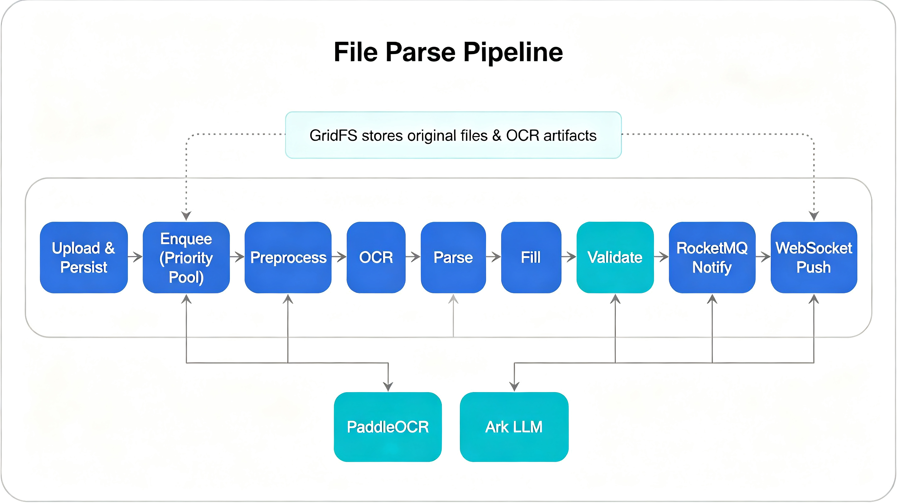
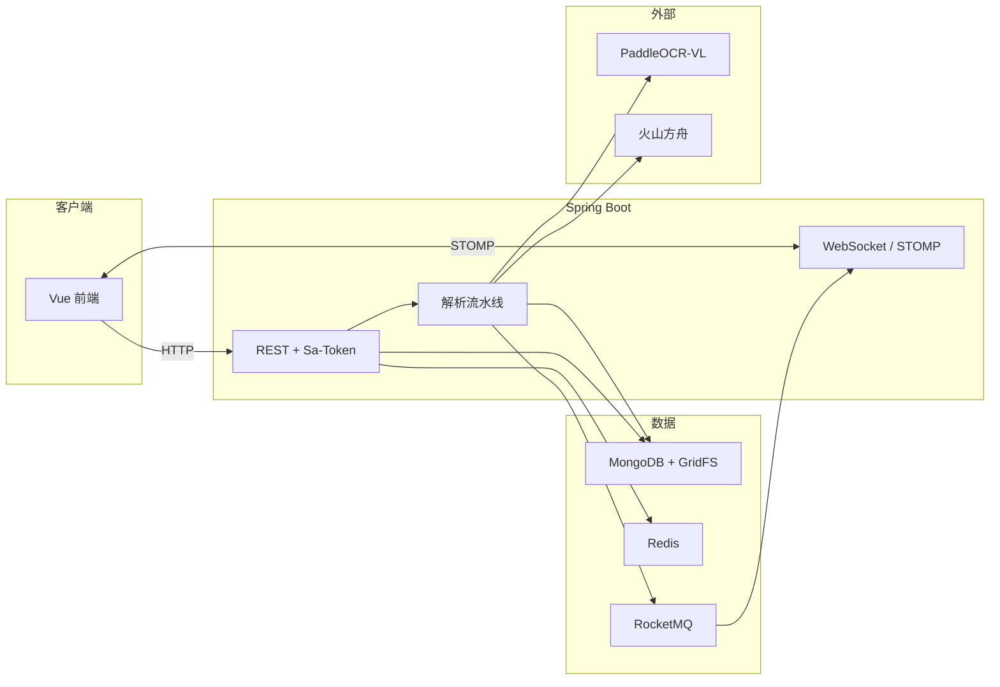
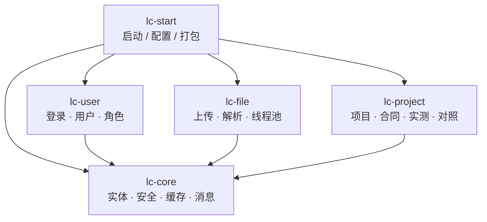

# LandCheck 后端

土地评估后端。合同、实测报告、规划材料解析成面积，再和项目方汇总、规划口径对照。

- 前端：[land-frontend](https://github.com/HongxHH/land-frontend)
- 部署：[TestDeploy](https://github.com/HongxHH/TestDeploy)

## 文件


| 材料      | 处理                         |
| ------- | -------------------------- |
| 合同、规划复核 | PDF：矫正 → 识别 → 抽取 → 回填      |
| 实测报告    | PDF：矫正 → 识别 → 抽取 → 回填 → 校验 |
| 容量指标    | PDF：识别 → 抽取 → 回填           |
| 项目方汇总   | Excel：解析 → 回填              |
| 其他      | 只保存                        |




## 架构




前端走 HTTP。解析进度和站内通知走 WebSocket。解析读写真件和识别结果，并调用版面识别、字段抽取。解析结束后发消息，再推回页面。项目查询走 Redis，Redis 不可用时直接查库。




业务模块只依赖 `lc-core`，互相不引用。解析写完数据后发事件，由项目模块清自己的缓存。

## 技术栈


| 项                  | 说明                         |
| ------------------ | -------------------------- |
| Java / Spring Boot | 21 / 3.5.8                 |
| 数据                 | MongoDB 8（副本集 `rs0`）、Redis |
| 消息                 | RocketMQ，结果推到 WebSocket    |
| 鉴权                 | Sa-Token                   |
| 文档                 | `/doc.html`，生产环境关闭         |


## 本地开发

JDK 21、Maven 3.9+。Mongo 必须是副本集，独立节点起不来。PDF 矫正需要本机 Conda 环境 `SR`。中间件用 TestDeploy 起。

```bash
mvn -pl lc-start -am spring-boot:run
```

接口文档：[http://localhost:8082/doc.html](http://localhost:8082/doc.html)。

打包：

```bash
mvn -pl lc-start -am package -DskipTests
java -jar lc-start/target/lc-start-0.0.1-SNAPSHOT.jar
```

